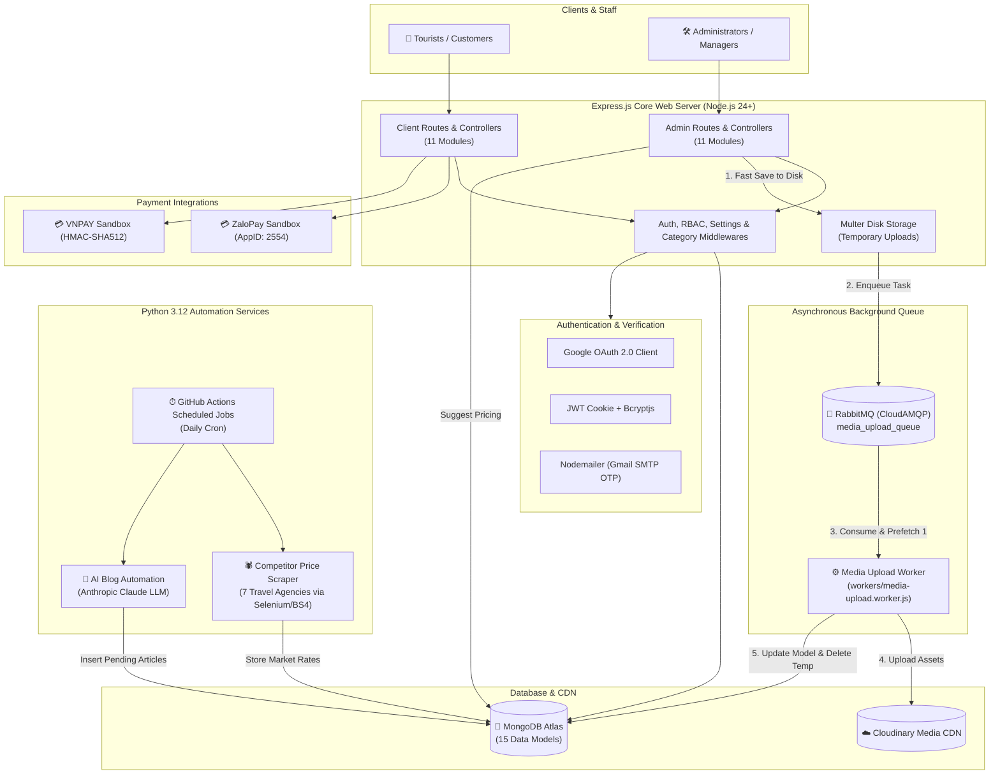

# 🌍 Travel Tour Booking — Full-Stack Web Platform

<p align="center">
  
  
  
  
  
  
  
  
  
</p>

> ⭐ **If you find this project helpful or inspiring, please consider starring the repository!** 🙏😊

**🔗 Live Production:** **[https://project-5-bw06.onrender.com](https://project-5-bw06.onrender.com)**  
**🔑 Demo Admin:** `admin@gmail.com` | `Admin@123`

---

## 📑 Table of Contents

- [Overview](#-overview)
- [System Architecture](#-system-architecture)
- [Key Features](#-key-features)
  - [Client Application](#-client-application)
  - [Admin Management Panel (RBAC)](#-admin-management-panel-rbac)
  - [Asynchronous Media Worker (RabbitMQ)](#-asynchronous-media-worker-rabbitmq)
  - [Smart Competitor Price Intelligence](#-smart-competitor-price-intelligence)
  - [AI Travel Blog Automation](#-ai-travel-blog-automation)
- [Tech Stack](#-tech-stack)
- [Project Structure](#-project-structure)
- [Installation & Quickstart](#-installation--quickstart)
- [Environment Variables](#-environment-variables)
- [Payment Gateways](#-payment-gateways)
- [Role-Based Access Control (RBAC) Matrix](#-role-based-access-control-rbac-matrix)
- [API & Route Map](#-api--route-map)
- [Background Workers & Automation](#-background-workers--automation)
- [Contributing](#-contributing)
- [License & Contact](#-license--contact)

---

## 🚀 Overview

**Travel Tour Booking** is an enterprise-grade, full-stack travel booking and management web platform developed with **Node.js (Express v5)**, **MongoDB (Mongoose v9)**, and **Pug**. 

The system provides a seamless experience for both tourists booking travel packages and tour operators managing complex inventory, pricing strategies, and content pipelines. It incorporates asynchronous job queues via **RabbitMQ** for non-blocking media uploads to **Cloudinary**, automated competitor price scraping across 7 national travel agencies, intelligent market-rate price suggestions, and autonomous AI-generated travel blogs using **Anthropic Claude**.

---

## 🏗 System Architecture

The following diagram illustrates the interaction between the Client, Admin Panel, Express Server, RabbitMQ Message Queue, MongoDB, Cloudinary CDN, and the Python automation sub-services:



---

## ✨ Key Features

### 👤 Client Application
- **Interactive Tour Discovery:** Browse tours categorized by regions (Northern, Central, Southern Vietnam, International), with breadcrumb navigation.
- **Multi-Factor Search & Filter:** Instant search by keywords, departure city, destination, duration, date, and price brackets.
- **Detailed Tour Presentation:** Image slider galleries, itinerary timeline, included/excluded services, and hotel/transport information.
- **Tiered Passenger Booking:** Distinct ticket selection and calculations for **Adults**, **Children**, and **Babies**.
- **Shopping Cart & Checkout:** Persistent shopping cart, selective item checkout, coupon discount validation (minimum spend & category restrictions).
- **Seat Inventory Reservation:** Safe stock lock (`reserveStock`) upon order creation and instant rollback (`releaseStock`) on payment abort.
- **Flexible Payments:** Support for Cash on Delivery (COD), Direct Bank Transfer, **ZaloPay**, and **VNPAY**.
- **Customer Account Portal:**
  - Standard email registration with 6-digit OTP verification.
  - One-click **Google Sign-In** via Google OAuth 2.0.
  - Password recovery with secure OTP flow.
  - **My Orders (`/my-order`)**: Real-time status tracking (`initial`, `paid`, `confirmed`, `done`, `cancel`).
  - Profile management and profile avatar customization.
- **Travel Blog:** Destination travel guides with SEO itineraries, tips, food recommendations, and FAQ.
- **Contact & Feedback:** Interactive inquiry form sending direct feedback to admin.

---

### 🔐 Admin Management Panel (RBAC)
- **Executive Dashboard:** Live statistics on monthly revenues, successful orders, customer registrations, and recent transactions.
- **Granular Role-Based Access Control (RBAC):** Permission matrix configuring read, create, edit, delete, and publish rights across 30+ functional permissions.
- **Tour Management:** Full CRUD, multi-image upload, soft deletion with **Trash Bin** recovery/permanent delete.
- **Hierarchical Category Tree:** Multi-level parent-child categorization.
- **Order Management:** Lifecycle state updates (`initial` ➔ `paid` ➔ `confirmed` ➔ `done` ➔ `cancel`), automatic seat release upon cancellation.
- **Promotions & Vouchers:** Configurable percentage or fixed discount coupons, usage caps, and validity periods.
- **Editorial Blog Management:** Review AI-generated draft articles, rich text formatting, approve to publish or reject.
- **Staff & Customer Accounts:** Manage internal operator credentials and review/toggle customer status (`active` / `inactive`).
- **Website Info Settings:** Real-time updates for website branding, logos, contact info, social links, and footer metadata.

---

### ⚡ Asynchronous Media Worker (RabbitMQ)
To ensure optimal HTTP response speeds and prevent request timeouts during high-resolution image uploads:
1. File uploads are temporarily written to disk via `Multer`.
2. The controller immediately responds to the user while publishing a lightweight task message to **RabbitMQ** (`media_upload_queue` / `media_upload_queue_dev`).
3. The background worker (`workers/media-upload.worker.js`) consumes tasks one-by-one (`prefetch(1)`), streams media to **Cloudinary**, updates the respective MongoDB document, and cleans up local temporary files.

---

### 💡 Smart Competitor Price Intelligence
- Located in `price_scraper/`, this automated service scrapes live tour packages from 7 major Vietnamese tour agencies: **Vietravel**, **Saigontourist**, **BenThanh Tourist**, **Vietnam Booking**, **PYS Travel**, **TUGO**, and **Hanoitourist**.
- **Admin Price Suggestion Engine:** When creating or editing a tour, the system analyzes matching destination and duration records scraped in the last 30 days. It presents:
  - Market median price (rounded to 10,000 VND).
  - Interquartile range (25th to 75th percentile).
  - A 1-click **"Dùng làm giá mới"** button to apply competitive pricing instantly.

---

### 🤖 AI Travel Blog Automation
- Located in `blog_automation/`, an automated script leverages the **Anthropic Claude API** to craft comprehensive travel guides for any active tours that lack dedicated blog posts.
- Automatically structures history, optimal seasons, day-by-day itineraries, cuisine guides, budget estimates, and FAQs.
- Embeds tour image galleries and inserts posts as `pending` for editorial review before publishing.

---

## 🛠 Tech Stack

| Layer | Technologies & Libraries |
|---|---|
| **Runtime & Framework** | Node.js (v24+), Express.js (v5.x) |
| **Database & ODM** | MongoDB Atlas, Mongoose (v9.x) |
| **Message Queue** | RabbitMQ (CloudAMQP / AMQP 0-9-1) via `amqplib` |
| **View Template Engine** | Pug (v3.x) with custom helpers & responsive CSS/JS |
| **Media & Storage** | Cloudinary API, Multer (disk storage temporary buffer) |
| **Authentication & Security** | JWT (`jsonwebtoken`), `bcryptjs`, Google OAuth (`google-auth-library`), `cookie-parser` |
| **Payment Gateways** | **ZaloPay API** (HMAC-SHA256, IPN Callback), **VNPAY API** (HMAC-SHA512) |
| **Mailing Service** | Nodemailer (Gmail SMTP App Password) |
| **Validation & Utilities** | Joi, Moment.js, Slugify, UUID, Crypto-js |
| **Data Scraping & AI** | Python 3.12, Anthropic Claude API, Selenium (Headless Chrome), BeautifulSoup4, Requests |
| **Architecture Tooling** | Madge (Dependency graph & circular check), Nodemon |
| **CI/CD & Hosting** | GitHub Actions (Cron Workflows), Render.com |

---

## 📂 Project Structure

Derived directly from the system dependency graph ([graph.json](file:///d:/FullStack2026/project-5/graph.json)):

```
project-5/
├── configs/                       # Configuration modules
│   ├── database.config.js         # MongoDB connection & Super Admin seeder
│   ├── google.config.js           # Google OAuth 2.0 client
│   ├── rabbitmq.config.js         # RabbitMQ connection & queue resolution
│   └── variable.config.js         # Global permissions, status lists, payment methods
├── controllers/
│   ├── admin/                     # 11 Admin Controllers
│   │   ├── account.controller.js  # Staff accounts & password resets
│   │   ├── blog.controller.js     # AI Blog review, draft, publish & delete
│   │   ├── category.controller.js # Tour categories CRUD & tree hierarchy
│   │   ├── contact.controller.js  # Customer feedback & inquiries
│   │   ├── dashboard.controller.js# Revenue analytics & summary statistics
│   │   ├── order.controller.js    # Order lifecycle management & status
│   │   ├── profile.controller.js  # Admin operator profile
│   │   ├── promotion.controller.js# Discount codes & coupon vouchers
│   │   ├── setting.controller.js  # Roles, permissions & website settings
│   │   ├── tour.controller.js     # Tour CRUD, trash bin & competitor pricing
│   │   └── user.controller.js     # Customer account management
│   └── client/                    # 11 Client Controllers
│       ├── account.controller.js  # Register (OTP), Login (Password/Google), Forgot PW
│       ├── blog.controller.js     # Travel guides & blog reading
│       ├── cart.controller.js     # Shopping cart & passenger calculation
│       ├── category.controller.js # Category listings & filter navigation
│       ├── contact.controller.js  # Inquiry submission
│       ├── home.controller.js     # Homepage, banners, featured & discount tours
│       ├── my-order.controller.js # Order tracking & history
│       ├── order.controller.js    # Checkout, ZaloPay & VNPAY gateway processing
│       ├── profile.controller.js  # Customer profile & avatar update
│       ├── search.controller.js   # Multi-criteria keyword & location search
│       └── tour.controller.js     # Tour detail & departure date views
├── helpers/                       # Reusable business logic helpers
│   ├── breadcrumb.helper.js       # Dynamic breadcrumb navigation generator
│   ├── categoryFilter.helper.js   # Recursive subcategory retrieval
│   ├── categoryTree.helper.js     # Nested hierarchical category tree builder
│   ├── generate.helper.js         # Token, OTP and Order code generators
│   ├── mail.helper.js             # HTML email templates & Nodemailer dispatcher
│   ├── order.helper.js            # Stock reserve/release, amount calculation, coupon check
│   ├── permission.helper.js       # In-controller permission verification
│   ├── priceSuggest.helper.js     # Market price median & quartile recommendation algorithm
│   ├── tour.helper.js             # Tour pricing formatting & discount processing
│   ├── upload-disk.helper.js      # Multer temporary disk storage for RabbitMQ pipeline
│   └── validate.helper.js         # Input validation helpers
├── middlewares/                   # Request processing middlewares
│   ├── admin/
│   │   ├── auth.middleware.js     # Admin JWT authentication & role loading
│   │   └── permission.middleware.js# Granular RBAC route-level gatekeeper
│   └── client/
│       ├── auth.middleware.js     # Mandatory customer authentication check
│       ├── category.midelware.js  # Injects global category tree into locals
│       ├── get-account.middlewares.js# Resolves logged-in customer account
│       └── setting.midelware.js   # Injects global website settings into locals
├── models/                        # 15 Mongoose Data Models
│   ├── accounts-admin.model.js    # Operator credentials, roles & statuses
│   ├── accounts-clients.model.js  # Registered customer accounts & avatars
│   ├── blog.model.js              # Travel blogs (status: pending, draft, active)
│   ├── cart.model.js              # Customer carts with checked state & passenger counts
│   ├── category.model.js          # Nested categories with slugs & avatars
│   ├── city.model.js              # Departure cities & locations
│   ├── competitor-price.model.js  # Scraped competitor market rates
│   ├── contact.model.js           # Customer inquiries & messages
│   ├── forgot-password.model.js   # Password reset OTP tokens
│   ├── order.model.js             # Booking orders, line items, discounts & stock flags
│   ├── otp-verification.model.js  # Account registration OTP verification
│   ├── promotion.model.js         # Discount coupons & applicability conditions
│   ├── role.model.js              # RBAC roles & assigned permission lists
│   ├── setting-website-info.model.js # Site metadata, branding & contact info
│   └── tour.model.js              # Tour itineraries, prices, gallery & stock
├── routes/                        # Application routing layer
│   ├── admin/                     # 12 Admin Route modules (prefixed with /admin)
│   └── client/                    # 11 Client Route modules
├── views/                         # 69 Pug Template files
│   ├── admin/                     # Admin layouts, pages & partials
│   └── client/                    # Client layouts, pages & partials
├── public/                        # Static assets (CSS, JS, images, icons)
├── validates/                     # Joi schema validations
├── workers/
│   └── media-upload.worker.js     # RabbitMQ media upload background worker
├── blog_automation/               # Python AI blog generation pipeline
├── price_scraper/                 # Python competitor price crawler
├── .github/workflows/             # GitHub Actions CI/CD (Daily cron jobs)
├── graph.json                     # System dependency graph
├── index.js                       # Main application entrypoint
└── package.json                   # Dependencies, scripts & metadata
```

---

## ⚡ Installation & Quickstart

### Prerequisites
- **Node.js**: v20.x or v24+
- **MongoDB**: Local MongoDB or MongoDB Atlas URI
- **RabbitMQ**: Local RabbitMQ broker or CloudAMQP instance
- **Python**: v3.10+ (optional, required only for scraper and AI blog generator)

### 1. Clone Repository
```bash
git clone https://github.com/Hieuit04/project-5.git
cd project-5
```

### 2. Install Node Dependencies
```bash
npm install
```

### 3. Configure Environment Variables
Create your local environment file:
```bash
cp .env.example .env
```
Open `.env` and fill in your actual credentials (refer to the [Environment Variables](#-environment-variables) section below).

### 4. Run Application
You can start the web server and background worker together:

```bash
# Start development server with auto-reload (worker runs embedded automatically)
npm start
```

Or run the media worker as an independent microservice in a dedicated process:
```bash
npm run worker:media
```

### 5. Access the Web Application
- **Customer Portal**: `http://localhost:3000`
- **Admin Control Panel**: `http://localhost:3000/admin`
- **Default Super Admin Account:**
  - **Email:** `admin@gmail.com`
  - **Password:** `Admin@123`
  *(Automatically seeded into MongoDB on first application startup)*

---

## 🔐 Environment Variables

Ensure all necessary variables are configured in `.env`:

```env
# ── Database ─────────────────────────────────────────────────
DATABASE="mongodb+srv://<username>:<password>@cluster0.xxxxx.mongodb.net/<dbname>?retryWrites=true&w=majority"

# ── Authentication & Session ──────────────────────────────────
JWT_SECRET="your_jwt_secret_key_here"
SESSION_SECRET="your_session_secret_key_here"

# ── Google OAuth 2.0 ─────────────────────────────────────────
GOOGLE_CLIENT_ID="your_google_oauth_client_id.apps.googleusercontent.com"

# ── Nodemailer (Gmail SMTP) ───────────────────────────────────
GMAIL_USER="your_email@gmail.com"
GMAIL_PASS="xxxx xxxx xxxx xxxx"    # 16-character Google App Password

# ── Cloudinary Media CDN ──────────────────────────────────────
CLOUDINARY_NAME="your_cloud_name"
CLOUDINARY_API_KEY="your_api_key"
CLOUDINARY_API_SECRET="your_api_secret"

# ── RabbitMQ Message Broker ───────────────────────────────────
RABBITMQ_URL="amqp://localhost:5672" # Or amqps://... CloudAMQP URL
RABBITMQ_MEDIA_QUEUE="media_upload_queue_dev"

# ── ZaloPay Gateway ───────────────────────────────────────────
ZALOPAY_APPID="2554"
ZALOPAY_KEY1="your_zalopay_key1"
ZALOPAY_KEY2="your_zalopay_key2"
ZALOPAY_ENDPOINT="https://sb-openapi.zalopay.vn/v2/create"

# ── VNPAY Gateway ─────────────────────────────────────────────
VNPAY_TMNCODE="your_vnpay_tmncode"
VNPAY_SECRET_KEY="your_vnpay_secret_key"
VNPAY_URL="https://sandbox.vnpayment.vn/paymentv2/vpcpay.html"

# ── Application Domain ────────────────────────────────────────
DOMAIN_WEBSITE="http://localhost:3000" # Use ngrok URL when testing webhooks locally

# ── AI Blog Automation (Anthropic Claude) ─────────────────────
ANTHROPIC_API_KEY="sk-ant-api-..."
BLOG_MODEL="claude-opus-5"
```

---

## 💳 Payment Gateways

The application provides out-of-the-box sandbox payment support:

### 1. ZaloPay Sandbox
- **App ID:** `2554`
- **Creation Endpoint:** `POST /order/payment-zalopay`
- **IPN Webhook:** `POST /order/payment-zalopay-callback`
- Integrates HMAC-SHA256 signature generation and automatic order status transitions to `paid`.

### 2. VNPAY Sandbox
- **Creation Endpoint:** `GET /order/payment-vnpay`
- **Result Handler:** `GET /order/payment-vnpay-result`
- Encodes secure hash with HMAC-SHA512 checksum validation against response parameters.

---

## 🛡 Role-Based Access Control (RBAC) Matrix

Administrators can customize fine-grained permissions per role from `/admin/setting/role`:

| Module | Available Permission Keys |
|---|---|
| **Dashboard** | `dashboard-view` |
| **Tours** | `tour-view`, `tour-create`, `tour-edit`, `tour-delete`, `tour-trash-view`, `tour-trash-restore`, `tour-trash-delete` |
| **Categories** | `category-view`, `category-create`, `category-edit`, `category-delete` |
| **Orders** | `order-view`, `order-edit`, `order-delete` |
| **Promotions** | `promotion-view`, `promotion-create`, `promotion-edit`, `promotion-delete` |
| **Blogs** | `blog-view`, `blog-edit`, `blog-publish`, `blog-delete` |
| **Admin Accounts** | `account-admin-view`, `account-admin-create`, `account-admin-edit`, `account-admin-change-password`, `account-admin-delete` |
| **Roles & Permissions** | `role-list-view`, `role-create`, `role-edit`, `role-delete` |
| **Website Settings** | `website-info-view`, `website-info-edit` |
| **Customer Accounts** | `user-view`, `user-edit`, `user-delete` |
| **Contact Inquiries** | `contact-view`, `contact-delete` |

---

## 🗺 API & Route Map

### 👤 Client Routes (`/`)
| HTTP Method | Route | Description |
|---|---|---|
| `GET` | `/` | Homepage with banners, featured & promotional tours |
| `GET` | `/tour` | Tour catalog with sorting & filtering |
| `GET` | `/tour/detail/:slug` | Detailed tour itinerary & departure booking |
| `GET` | `/category/:slug` | Filter tours by category |
| `GET` | `/search` | Search tours by location, date, price & keyword |
| `GET`, `POST`, `PATCH`, `DELETE` | `/cart` | Shopping cart management |
| `POST` | `/order/create` | Place tour booking order |
| `POST` | `/order/payment-zalopay` | Initiate ZaloPay payment transaction |
| `POST` | `/order/payment-zalopay-callback` | ZaloPay IPN server-to-server webhook |
| `GET` | `/order/payment-vnpay` | Initiate VNPAY payment transaction |
| `GET` | `/order/payment-vnpay-result` | VNPAY redirect return handler |
| `GET` | `/order/success` | Order confirmation screen |
| `GET`, `POST` | `/account/register` | Register new customer account with OTP |
| `POST` | `/account/register/verify-otp` | Verify registration OTP code |
| `GET`, `POST` | `/account/login` | Email/password login |
| `POST` | `/account/login/google` | Google OAuth 2.0 authentication |
| `GET`, `POST` | `/account/password/forgot` | Password reset request via OTP |
| `GET`, `POST` | `/account/password/reset` | Complete password reset |
| `GET` | `/account/logout` | Customer session logout |
| `GET` | `/my-order` | Customer booking history & status |
| `GET`, `PATCH` | `/profile` | Customer profile management |
| `GET` | `/blog` | Travel blog directory |
| `GET` | `/blog/detail/:slug` | Travel blog article reading |
| `GET`, `POST` | `/contact` | Customer contact & inquiry submission |

### 🛠 Admin Routes (`/admin`)
| HTTP Method | Route | Description |
|---|---|---|
| `GET` | `/admin/dashboard` | Main operational statistics & revenue charts |
| `GET`, `POST`, `PATCH`, `DELETE` | `/admin/tour` | Tour CRUD operations |
| `GET`, `PATCH`, `DELETE` | `/admin/tour/trash` | Soft-deleted tour recovery & permanent purge |
| `GET` | `/admin/tour/price-suggest` | Live market price suggestion endpoint |
| `GET`, `POST`, `PATCH`, `DELETE` | `/admin/category` | Category tree management |
| `GET`, `PATCH`, `DELETE` | `/admin/order` | Order status management & details |
| `GET`, `POST`, `PATCH`, `DELETE` | `/admin/promotion` | Discount coupon management |
| `GET`, `PATCH`, `DELETE` | `/admin/blog` | Editorial review, approve & publish AI blogs |
| `GET`, `POST`, `PATCH`, `DELETE` | `/admin/account` | Staff accounts & permission assignments |
| `GET`, `POST`, `PATCH`, `DELETE` | `/admin/setting/role` | Roles & permission matrices |
| `GET`, `POST` | `/admin/setting/website-info` | Website global metadata & branding |
| `GET`, `PATCH`, `DELETE` | `/admin/user` | Customer management & account lock/unlock |
| `GET`, `DELETE` | `/admin/contact` | Review customer feedback messages |
| `GET`, `PATCH` | `/admin/profile` | Personal admin profile & password update |

---

## 🤖 Background Workers & Automation

### 1. Media Worker (`workers/media-upload.worker.js`)
```bash
# Start standalone media worker
npm run worker:media
```
Listens to RabbitMQ, retrieves uploaded images from local disk, uploads to Cloudinary CDN, updates MongoDB records, and deletes local temporary files.

### 2. Competitor Price Scraper (`price_scraper/`)
```bash
cd price_scraper
pip install -r requirements.txt

# Run full crawler across 7 agencies and save to MongoDB
python scrape_prices.py

# Run dry-run for specific agencies
python scrape_prices.py --sources pys,tugo --max-pages 2 --dry-run
```

### 3. AI Travel Blog Generation (`blog_automation/`)
```bash
cd blog_automation
pip install -r requirements.txt

# Generate articles for active tours lacking blog posts
python generate_blog.py

# Preview article generation without saving to DB
python generate_blog.py --slug <tour-slug> --dry-run
```

### 4. GitHub Actions Automation (`.github/workflows/scheduled-jobs.yml`)
- Runs **Price Scraper** daily at `02:00` (Vietnam Time).
- Runs **AI Blog Generator** daily at `06:00` (Vietnam Time).

---

## 🤝 Contributing

Contributions are warmly welcomed! Please follow these steps:

1. Fork this repository.
2. Create your feature branch:
   ```bash
   git checkout -b feature/amazing-feature
   ```
3. Commit your changes:
   ```bash
   git commit -m "feat: Add amazing new feature"
   ```
4. Push to your branch:
   ```bash
   git push origin feature/amazing-feature
   ```
5. Open a Pull Request.

---

## 📄 License & Contact

- **License:** Distributed under the **MIT License**. See [LICENSE](./LICENSE) for details.
- **Author:** Đinh Trọng Hiếu
- **Email:** [hieu15904@gmail.com](mailto:hieu15904@gmail.com)
- **GitHub:** [@Hieuit04](https://github.com/Hieuit04)
- **Live Demo:** [https://project-5-bw06.onrender.com](https://project-5-bw06.onrender.com)
