# SƠ ĐỒ LỚP THIẾT KẾ (DESIGN CLASS DIAGRAM) - CHỨC NĂNG QUẢN LÝ NHÓM QUYỀN
> **Dự án:** Hệ thống Website Du lịch & Quản lý Tour (Project-5)  
> **Ngôn ngữ & Nền tảng:** **Node.js, Express.js, MongoDB (Mongoose ODM), Pug Template & Client JS**

---

## I. GIẢI THÍCH LỚP `DAO` VÀ TẠI SAO PHẢI CÓ TRONG SƠ ĐỒ

Lớp **`DAO`** với thuộc tính `-con : Connection` chính là **lớp cha cơ sở (Base Data Access Object)**:
* **`-con : Connection`**: Biểu diễn đối tượng kết nối cơ sở dữ liệu. Trong môi trường Node.js / MongoDB, đây chính là đối tượng `mongoose.Connection` (được tạo ra khi gọi `mongoose.connect(process.env.DATABASE)` trong file `configs/database.config.js`).
* **`+DAO()`**: Hàm khởi tạo (constructor) chịu trách nhiệm lấy hoặc thiết lập kết nối CSDL `con`.
* **Mối quan hệ kế thừa (`DAO <|-- RoleDAO`)**: Lớp **`RoleDAO`** kế thừa từ `DAO` để tái sử dụng kết nối `con`, đồng thời hiện thực các hàm nghiệp vụ truy vấn cụ thể cho bảng nhóm quyền (`roles`).

---

## II. SƠ ĐỒ LỚP THIẾT KẾ ĐẦY ĐỦ (CÓ LỚP `DAO` VÀ KẾ THỪA `RoleDAO`)

Sơ đồ dưới đây được vẽ đúng 100% theo mẫu chuẩn môn **Phân tích Thiết kế Hệ thống Hướng đối tượng (OOAD)** của các trường đại học (như PTIT, Bách Khoa...), đồng thời chuyển đổi chuẩn xác sang ngôn ngữ **Node.js / Web DOM**:

* Đầy đủ lớp cha **`DAO`** và lớp con **`RoleDAO`** kế thừa (`<|--`).
* Mọi thuộc tính đều tuân thủ nghiêm ngặt định dạng: 👉 **`-tênTrường: KiểuDữLiệu`**.
* Mọi phương thức đều tuân thủ định dạng: 👉 **`+tênPhươngThức(thamSố: Kiểu): KiểuTrảVề`**.

```mermaid
classDiagram
    direction TB

    %% ==========================================
    %% 1. TẦNG GIAO DIỆN (BOUNDARY / VIEW)
    %% ==========================================
    class SettingListView {
        <<boundary>>
        -linkWebsiteInfo: HTMLAnchorElement
        -linkAccountAdmin: HTMLAnchorElement
        -linkRoleList: HTMLAnchorElement
        -user: AccountAdmin
        +render(): HTML
    }

    class RoleManageView {
        <<boundary>>
        -formSearch: HTMLFormElement
        -inputSearch: HTMLInputElement
        -btnSearch: HTMLButtonElement
        -btnCreate: HTMLAnchorElement
        -tblRole: HTMLTableElement
        -chkCheckAll: HTMLInputElement
        -chkItems: NodeList~HTMLInputElement~
        -formChangeMulti: HTMLFormElement
        -selAction: HTMLSelectElement
        -btnApplyMulti: HTMLButtonElement
        -listBtnDelete: NodeList~HTMLAnchorElement~
        -selPagination: HTMLSelectElement
        -user: AccountAdmin
        +render(settingRoleList: Array, pagination: Object): HTML
        +handleSearch(keyword: String): void
        +handleDelete(id: String): void
        +handleChangeMulti(listId: Array, option: String): void
        +handlePagination(page: Number): void
    }

    class RoleCreateView {
        <<boundary>>
        -formRoleCreate: HTMLFormElement
        -inputRoleName: HTMLInputElement
        -inputDescription: HTMLInputElement
        -chkPermissions: NodeList~HTMLInputElement~
        -btnSubmit: HTMLButtonElement
        -user: AccountAdmin
        +render(permissionList: Array): HTML
        +validateForm(): Boolean
        +handleSubmit(event: Event): void
    }

    class RoleEditView {
        <<boundary>>
        -formRoleEdit: HTMLFormElement
        -inputId: HTMLInputElement
        -inputRoleName: HTMLInputElement
        -inputDescription: HTMLInputElement
        -chkPermissions: NodeList~HTMLInputElement~
        -btnSubmit: HTMLButtonElement
        -user: AccountAdmin
        +render(roleDetail: Role, permissionList: Array): HTML
        +validateForm(): Boolean
        +handleSubmit(event: Event): void
    }

    %% ==========================================
    %% 2. TẦNG ĐIỀU KHIỂN (CONTROLLER)
    %% ==========================================
    class SettingController {
        <<controller>>
        -roleDAO: RoleDAO
        +roleList(req: Request, res: Response): Promise~void~
        +roleCreate(req: Request, res: Response): void
        +roleCreatePost(req: Request, res: Response): Promise~void~
        +roleEdit(req: Request, res: Response): Promise~void~
        +roleEditPatch(req: Request, res: Response): Promise~void~
        +roleDeletePatch(req: Request, res: Response): Promise~void~
        +roleChangeMultiPatch(req: Request, res: Response): Promise~void~
    }

    %% ==========================================
    %% 3. TẦNG TRUY CẬP DỮ LIỆU (DATA ACCESS OBJECT - DAO)
    %% ==========================================
    class DAO {
        <<dataAccess>>
        -con: Connection
        +DAO()
    }

    class RoleDAO {
        <<dataAccess>>
        +RoleDAO()
        +getRoleById(id: String): Promise~Role~
        +addRole(role: Role): Promise~Boolean~
        +updateRole(id: String, role: Role): Promise~Boolean~
        +deleteRole(id: String, adminId: String): Promise~Boolean~
        +changeMultiRole(listId: Array, option: String, adminId: String): Promise~Boolean~
        +getRoleList(keyword: String, page: Number, limit: Number): Promise~Object~
    }

    %% ==========================================
    %% 4. TẦNG THỰC THỂ (ENTITY MODEL)
    %% ==========================================
    class Role {
        <<entity>>
        -_id: ObjectId
        -roleName: String
        -description: String
        -rolePermissions: Array~String~
        -slug: String
        -createdBy: String
        -updatedBy: String
        -deleted: Boolean
        -deletedBy: String
        -deletedAt: Date
        -createdAt: Date
        -updatedAt: Date
    }

    class PermissionItem {
        <<entity>>
        -label: String
        -value: String
    }

    class AccountAdmin {
        <<entity>>
        -_id: ObjectId
        -fullName: String
        -email: String
        -phone: String
        -role: String
        -status: String
    }

    %% ==========================================
    %% MỐI QUAN HỆ GIỮA CÁC LỚP (RELATIONSHIPS)
    %% ==========================================
    SettingListView --> RoleManageView : Điều hướng
    RoleManageView --> RoleCreateView : Mở tạo mới
    RoleManageView --> RoleEditView : Mở chỉnh sửa

    RoleManageView ..> SettingController : Gửi HTTP Request
    RoleCreateView ..> SettingController : Gửi HTTP Request
    RoleEditView ..> SettingController : Gửi HTTP Request

    SettingController --> RoleDAO : Gọi truy vấn

    DAO <|-- RoleDAO : Kế thừa
    RoleDAO --> Role : Thao tác CRUD
    Role "1" --> "*" PermissionItem : Chứa danh sách quyền
    AccountAdmin "n" --> "1" Role : Gán theo nhóm quyền
```

---

## III. BẢNG ĐỐI CHIẾU SO SÁNH GIỮA SƠ ĐỒ CŨ (JAVA) VÀ SƠ ĐỒ MỚI (NODE.JS)

| Thành phần | Sơ đồ cũ (Java Swing Desktop) | Sơ đồ mới (Node.js Web MVC) | Lý do chuyển đổi |
| :--- | :--- | :--- | :--- |
| **Màn hình chính** | `AdminHomeView` (`JButton`, `user: NhanVien`) | `SettingListView` (`HTMLAnchorElement`, `user: AccountAdmin`) | Web không có `JButton`. Người dùng click vào thẻ `<a href="/admin/setting/role/list">` ở trang "Cài đặt chung". |
| **Giao diện danh sách** | `RoleManageView` (`tblRole: JTable`, `JButton`) | `RoleManageView` (`tblRole: HTMLTableElement`, các input HTML, JustValidate) | Trên Web dùng bảng HTML `<table>`, form tìm kiếm HTML `<form>`, bắt sự kiện bằng JavaScript. |
| **Giao diện form** | `RoleEditView` (`JTextField`, `JCheckBox`) | `RoleEditView`, `RoleCreateView` (`HTMLInputElement`, NodeList checkbox HTML) | Web dùng thẻ `<input type="text">` và `<input type="checkbox">`. |
| **Lớp cha DAO** | `DAO` (`-con: Connection`, `+DAO()`) | `DAO` (`-con: Connection`, `+DAO()`) | **Giữ nguyên chuẩn thiết kế OOP:** `-con: Connection` đại diện cho kết nối `mongoose.Connection` của MongoDB trong Node.js. |
| **Lớp con RoleDAO** | `RoleDAO` kế thừa `DAO` | `RoleDAO` kế thừa `DAO` | Chứa các phương thức bất đồng bộ (`Promise`) phù hợp với Node.js: `getRoleList`, `getRoleById`, `addRole`, `updateRole`, `deleteRole`, `changeMultiRole`. |
| **Lớp thực thể** | `NhomQuyenQuanTri` (`rolePermissions: String`) | `Role` (`rolePermissions: Array<String>`) | Tên model trong database MongoDB thực tế là `Role`, và quyền được lưu dưới dạng mảng các chuỗi (`Array<String>`). |
| **Lớp quyền** | `Quyen` (`lable`, `value`) | `PermissionItem` (`label: String`, `value: String`) | Khớp với hằng số `permissionList` trong file `configs/variable.config.js`. |

---

## IV. CÁCH GIẢI THÍCH VỚI THẦY GIÁO VỀ LỚP `DAO`

Khi thầy giáo hỏi về lớp `DAO` trong sơ đồ này:
1. **Bản chất của `DAO` trong Node.js:**
   *"Thưa thầy, lớp `DAO` là lớp cơ sở quản lý kết nối CSDL chung (`-con: Connection`). Trong dự án Node.js của em, thuộc tính `-con` chính là đối tượng `mongoose.connection` được thiết lập khi ứng dụng kết nối tới MongoDB."*
2. **Bản chất của `RoleDAO` kế thừa `DAO`:**
   *"Lớp `RoleDAO` kế thừa từ `DAO` để sử dụng chung kết nối CSDL, đồng thời đóng gói tất cả các thao tác truy vấn dữ liệu của nhóm quyền (như thêm mới, cập nhật, xóa mềm, phân trang và tìm kiếm theo keyword) tách biệt khỏi tầng Controller."*
3. **Mối liên hệ giữa View $\rightarrow$ Controller $\rightarrow$ DAO $\rightarrow$ Entity:**
   *"Mô hình đi theo đúng kiến trúc phân lớp chuẩn:*
   * *`View (Pug/JS DOM)` tương tác với người dùng qua HTTP Request.*
   * *`SettingController` tiếp nhận request, kiểm tra quyền và gọi `RoleDAO`.*
   * *`RoleDAO` thực hiện truy vấn và ánh xạ dữ liệu về thực thể `Role` trong MongoDB."*
