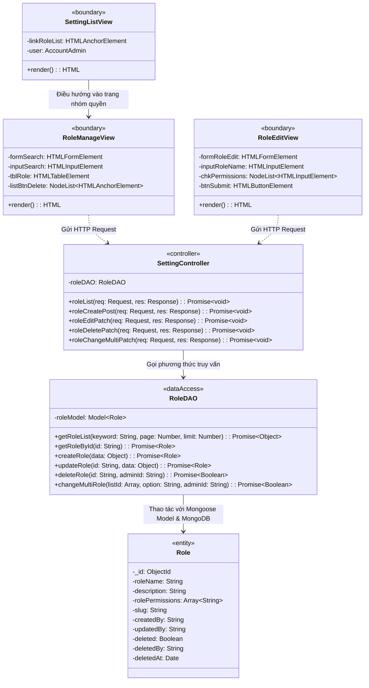

# SƠ ĐỒ LỚP THIẾT KẾ (DESIGN CLASS DIAGRAM) - CHỨC NĂNG QUẢN LÝ NHÓM QUYỀN
> **Dự án:** Hệ thống Website Du lịch & Quản lý Tour (Project-5)  
> **Kiến trúc:** Web MVC (Model - View - Controller) trên nền tảng **Node.js, Express.js, MongoDB (Mongoose ODM), Pug Template & Client JS**

---

## I. TẠI SAO THẦY GIÁO YÊU CẦU SỬA LẠI SƠ ĐỒ CŨ?

Nhìn vào sơ đồ thiết kế cũ trong ảnh, có **3 lỗi sai cốt lõi** khiến thầy giáo bắt vẽ lại:

1. **Nhầm lẫn giữa ứng dụng Desktop (Java Swing) và ứng dụng Web:**
   * Sơ đồ cũ sử dụng các lớp giao diện của **Java Swing**: `JButton`, `JTextField`, `JTable`, `JCheckBox`, `ActionEvent`, `...Frm`.
   * Dự án của bạn là **Web Application** chạy trên trình duyệt. Phía giao diện (View) là các template **Pug (`.pug`)** sinh mã HTML và các phần tử DOM (`HTMLInputElement`, `HTMLTableElement`, `HTMLButtonElement`, `HTMLAnchorElement`), tương tác qua **Fetch API (AJAX)** chứ không có các nút bấm Desktop của Java.

2. **Dùng kết nối JDBC của CSDL quan hệ thay vì Mongoose ODM trên MongoDB:**
   * Sơ đồ cũ có lớp `DAO` với thuộc tính `-con : Connection` (kết nối JDBC truyền thống của Java tới MySQL/SQL Server).
   * Dự án thực tế dùng CSDL NoSQL **MongoDB** thông qua thư viện **Mongoose**. Mongoose Model vừa đóng vai trò định nghĩa Schema, vừa cung cấp trực tiếp các hàm truy vấn (`find`, `findById`, `save`, `updateOne`, `updateMany`...).

3. **Tên lớp, thuộc tính và phương thức không khớp với Source Code:**
   * Trong code thực tế:
     * Model tên là **`Role`** (trong `models/role.model.js`), không phải `NhomQuyenQuanTri`.
     * Thuộc tính phân quyền là **`rolePermissions: Array<String>`**, không phải `rolePermissions: String`.
     * Tầng Controller là **`SettingController`** (`controllers/admin/setting.controller.js`), xử lý các hành động: `roleList`, `roleCreate`, `roleCreatePost`, `roleEdit`, `roleEditPatch`, `roleDeletePatch`, `roleChangeMultiPatch`.
     * Tầng Router & Middleware gồm **`setting.route.js`**, **`auth.middleware.js`**, **`permission.middleware.js`**.

---

## II. SƠ ĐỒ LỚP THIẾT KẾ CHUẨN KIẾN TRÚC NODE.JS / EXPRESS.JS

Dưới đây là sơ đồ lớp thiết kế được vẽ bằng mã **UML (Mermaid)** bám sát 100% cấu trúc `graph.json` và mã nguồn thực tế của dự án. Tất cả các trường và phương thức đều tuân thủ chặt chẽ định dạng chuẩn UML:  
👉 **`-tênTrường: KiểuDữLiệu`** và **`+tênPhươngThức(thamSố: Kiểu): KiểuTrảVề`**.

```mermaid
classDiagram
    direction TB

    %% ==========================================
    %% 1. TẦNG GIAO DIỆN (VIEW / BOUNDARY LAYER)
    %% ==========================================
    class AdminSiderView {
        <<boundary>>
        -linkDashboard: HTMLAnchorElement
        -linkCategory: HTMLAnchorElement
        -linkTour: HTMLAnchorElement
        -linkPromotion: HTMLAnchorElement
        -linkBlog: HTMLAnchorElement
        -linkOrder: HTMLAnchorElement
        -linkUser: HTMLAnchorElement
        -linkContact: HTMLAnchorElement
        -linkSetting: HTMLAnchorElement
        -linkProfile: HTMLAnchorElement
        -linkLogout: HTMLAnchorElement
        +render(): HTML
    }

    class SettingListView {
        <<boundary>>
        -linkWebsiteInfo: HTMLAnchorElement
        -linkAccountAdmin: HTMLAnchorElement
        -linkRoleList: HTMLAnchorElement
        -user: AccountAdmin
        +render(): HTML
    }

    class RoleManageView {
        <<boundary>>
        -formSearch: HTMLFormElement
        -inputSearch: HTMLInputElement
        -btnSearch: HTMLButtonElement
        -btnCreate: HTMLAnchorElement
        -tblRole: HTMLTableElement
        -chkCheckAll: HTMLInputElement
        -chkItems: NodeList~HTMLInputElement~
        -formChangeMulti: HTMLFormElement
        -selAction: HTMLSelectElement
        -btnApplyMulti: HTMLButtonElement
        -listBtnDelete: NodeList~HTMLAnchorElement~
        -selPagination: HTMLSelectElement
        -user: AccountAdmin
        +render(settingRoleList: Array, pagination: Object, pers: Array): HTML
        +handleSearch(keyword: String): void
        +handleDelete(id: String): void
        +handleChangeMulti(listId: Array, option: String): void
        +handlePagination(page: Number): void
    }

    class RoleCreateView {
        <<boundary>>
        -formRoleCreate: HTMLFormElement
        -inputRoleName: HTMLInputElement
        -inputDescription: HTMLInputElement
        -chkPermissions: NodeList~HTMLInputElement~
        -btnSubmit: HTMLButtonElement
        -linkBack: HTMLAnchorElement
        +render(permissionList: Array, pers: Array): HTML
        +validateForm(): Boolean
        +handleSubmit(event: Event): void
    }

    class RoleEditView {
        <<boundary>>
        -formRoleEdit: HTMLFormElement
        -inputId: HTMLInputElement
        -inputRoleName: HTMLInputElement
        -inputDescription: HTMLInputElement
        -chkPermissions: NodeList~HTMLInputElement~
        -btnSubmit: HTMLButtonElement
        -linkBack: HTMLAnchorElement
        +render(roleDetail: Role, permissionList: Array, pers: Array): HTML
        +validateForm(): Boolean
        +handleSubmit(event: Event): void
    }

    %% ==========================================
    %% 2. TẦNG ĐIỀU HƯỚNG & KIỂM SOÁT (ROUTER & MIDDLEWARES)
    %% ==========================================
    class SettingRouter {
        <<router>>
        -router: ExpressRouter
        +get(path: String, handler: Function): void
        +post(path: String, middleware: Function, handler: Function): void
        +patch(path: String, middleware: Function, handler: Function): void
    }

    class AuthMiddleware {
        <<middleware>>
        +verifyToken(req: Request, res: Response, next: NextFunction): Promise~void~
    }

    class PermissionMiddleware {
        <<middleware>>
        +checkPermission(permission: String): Function
    }

    %% ==========================================
    %% 3. TẦNG XỬ LÝ NGHIỆP VỤ (CONTROLLER LAYER)
    %% ==========================================
    class SettingController {
        <<controller>>
        +roleList(req: Request, res: Response): Promise~void~
        +roleCreate(req: Request, res: Response): void
        +roleCreatePost(req: Request, res: Response): Promise~void~
        +roleEdit(req: Request, res: Response): Promise~void~
        +roleEditPatch(req: Request, res: Response): Promise~void~
        +roleDeletePatch(req: Request, res: Response): Promise~void~
        +roleChangeMultiPatch(req: Request, res: Response): Promise~void~
    }

    %% ==========================================
    %% 4. TẦNG THỰC THỂ DỮ LIỆU & TRUY VẤN (MODEL / ODM)
    %% ==========================================
    class Role {
        <<MongooseModel>>
        -_id: ObjectId
        -roleName: String
        -description: String
        -rolePermissions: Array~String~
        -slug: String
        -createdBy: String
        -updatedBy: String
        -deleted: Boolean
        -deletedBy: String
        -deletedAt: Date
        -createdAt: Date
        -updatedAt: Date
        +find(filter: Object): Query
        +findById(id: String): Query
        +countDocuments(filter: Object): Query
        +findByIdAndUpdate(id: String, updateData: Object): Query
        +updateOne(filter: Object, updateData: Object): Query
        +updateMany(filter: Object, updateData: Object): Query
        +save(): Promise~Role~
    }

    class AccountAdmin {
        <<MongooseModel>>
        -_id: ObjectId
        -fullName: String
        -email: String
        -phone: String
        -role: String
        -positionCompany: String
        -status: String
        -passWord: String
        -avatar: String
        -deleted: Boolean
        +findOne(filter: Object): Query
        +findById(id: String): Query
    }

    class PermissionItem {
        <<configEntity>>
        -label: String
        -value: String
    }

    %% ==========================================
    %% MỐI QUAN HỆ GIỮA CÁC LỚP (RELATIONSHIPS)
    %% ==========================================
    AdminSiderView --> SettingListView : Click menu "Cài đặt chung"
    SettingListView --> RoleManageView : Click ô "Nhóm quyền"
    RoleManageView --> RoleCreateView : Mở trang tạo mới (+ Tạo mới)
    RoleManageView --> RoleEditView : Mở trang chỉnh sửa (Icon Sửa)

    RoleManageView ..> SettingRouter : Gửi HTTP GET (tìm kiếm, phân trang) / PATCH (xóa, đổi trạng thái)
    RoleCreateView ..> SettingRouter : Gửi HTTP POST (tạo mới nhóm quyền)
    RoleEditView ..> SettingRouter : Gửi HTTP PATCH (cập nhật nhóm quyền)

    SettingRouter ..> AuthMiddleware : Xác thực JWT & lấy quyền hiện tại
    SettingRouter ..> PermissionMiddleware : Chặn truy cập nếu thiếu quyền
    SettingRouter --> SettingController : Chuyển tiếp Request tới hàm xử lý

    SettingController ..> Role : Thao tác CRUD dữ liệu vào MongoDB
    SettingController ..> PermissionItem : Nạp danh sách quyền (permissionList)
    AuthMiddleware ..> AccountAdmin : Kiểm tra tài khoản đăng nhập
    AuthMiddleware ..> Role : Nạp quyền vào res.locals.pers

    AccountAdmin "n" --> "1" Role : Thuộc về 1 nhóm quyền (account.role = role._id)
    Role "1" ..> "n" PermissionItem : Lưu trữ danh sách mã quyền được cấp (rolePermissions)
```

---

## III. PHIÊN BẢN MỞ RỘNG: NẾU THẦY BẮT BUỘC PHẢI CÓ LỚP `RoleDAO`

Nếu giảng viên của bạn thuộc phong cách đào tạo bắt buộc đồ án phải có lớp **Data Access Object (DAO)** riêng biệt (theo chuẩn giáo trình ĐH môn Phân tích Thiết kế Hệ thống):

Ta hoàn toàn có thể biểu diễn một lớp đóng gói **`RoleDAO`** (Data Access Object) đóng vai trò trung gian giữa `SettingController` và `Role Model (Mongoose)`. Tất cả các thuộc tính và phương thức đều theo đúng cú pháp `-tênTrường: KiểuDữLiệu`:

---

## IV. BẢNG MÔ TẢ CHI TIẾT CÁC LỚP TRONG THIẾT KẾ

### 1. Tầng Giao diện (Boundary / View)
| Tên lớp | File tương ứng | Các thuộc tính & Chức năng chính |
| :--- | :--- | :--- |
| **`AdminSiderView`** | `views/admin/partials/sider.pug` | Menu thanh bên trái gồm các đường link: `linkSetting` (Cài đặt chung), `linkProfile` (Thông tin cá nhân), `linkLogout` (Đăng xuất), v.v. |
| **`SettingListView`** | `views/admin/pages/setting-list.pug` | Màn hình "Cài đặt chung" chứa 3 ô: `linkWebsiteInfo` (Thông tin website), `linkAccountAdmin` (Tài khoản quản trị), `linkRoleList` (Nhóm quyền) điều hướng sang `RoleManageView`. |
| **`RoleManageView`** | `views/admin/pages/setting-role-list.pug` `public/admin/assets/js/script.js` | Hiển thị bảng danh sách nhóm quyền (`tblRole`), ô tìm kiếm (`inputSearch`), phân trang (`selPagination`), nút xóa mềm (`listBtnDelete`) và thao tác áp dụng hàng loạt (`formChangeMulti`). |
| **`RoleCreateView`** | `views/admin/pages/setting-role-create.pug` `public/admin/assets/js/script.js` | Hiển thị form tạo nhóm quyền với các checkbox danh mục quyền (`chkPermissions`), kiểm tra hợp lệ dữ liệu (JustValidate) và gửi request POST bằng AJAX. |
| **`RoleEditView`** | `views/admin/pages/setting-role-edit.pug` `public/admin/assets/js/script.js` | Hiển thị dữ liệu chi tiết nhóm quyền cần sửa, tích chọn sẵn các quyền đã có, kiểm tra hợp lệ và gửi request PATCH bằng AJAX. |

### 2. Tầng Điều hướng & Kiểm soát (Router & Middleware)
| Tên lớp | File tương ứng | Các phương thức & Chức năng chính |
| :--- | :--- | :--- |
| **`SettingRouter`** | `routes/admin/setting.route.js` | Định nghĩa các endpoint URI chuẩn RESTful (`/role/list`, `/role/create`, `/role/edit/:id`, `/role/delete/:id`, `/role/change-multi`). |
| **`AuthMiddleware`** | `middlewares/admin/auth.middleware.js` | `verifyToken`: Giải mã cookie JWT Token, xác thực người dùng đang đăng nhập và nạp danh sách quyền của tài khoản vào biến `res.locals.pers`. |
| **`PermissionMiddleware`** | `middlewares/admin/permission.middleware.js` | `checkPermission`: Middleware chặn truy cập ở cấp độ route (ví dụ: kiểm tra quyền `role-create`, `role-edit`, `role-delete`). |

### 3. Tầng Xử lý Logic (Controller)
| Tên lớp | File tương ứng | Các phương thức chính |
| :--- | :--- | :--- |
| **`SettingController`** | `controllers/admin/setting.controller.js` | • `roleList`: Tìm kiếm theo slug regex, tính toán phân trang (`limit = 5`, `skip`), render giao diện. • `roleCreate`: Render form tạo nhóm quyền kèm `permissionList`. • `roleCreatePost`: Gán `createdBy`, lưu vào MongoDB, trả kết quả JSON. • `roleEdit`: Tìm nhóm quyền theo `_id`, render giao diện chỉnh sửa. • `roleEditPatch`: Gọi `findByIdAndUpdate` cập nhật tên, mô tả, mảng quyền. • `roleDeletePatch`: Soft delete (`deleted: true`, `deletedBy`, `deletedAt`). • `roleChangeMultiPatch`: Xử lý xóa mềm hàng loạt (`updateMany`). |

### 4. Tầng Dữ liệu (Model / ODM)
| Tên lớp | File tương ứng | Thuộc tính & Chức năng |
| :--- | :--- | :--- |
| **`Role`** | `models/role.model.js` | Mongoose Model tương ứng với collection `roles` trong MongoDB. Chứa `-_id: ObjectId`, `-roleName: String`, `-description: String`, `-rolePermissions: Array<String>`, `-slug: String`, `-deleted: Boolean`... và các hàm truy vấn ODM (`find`, `findById`, `updateOne`...). |
| **`AccountAdmin`** | `models/accounts-admin.model.js` | Đại diện cho tài khoản quản trị viên. Liên kết với `Role` thông qua trường `-role: String` (lưu ID của nhóm quyền). |
| **`PermissionItem`** | `configs/variable.config.js` | Danh sách hằng số định nghĩa sẵn các quyền trong hệ thống gồm `-label: String`, `-value: String` (ví dụ: `tour-view`, `role-edit`, `category-create`...). |

---

## V. CÁCH TRẢ LỜI VỚI THẦY GIÁO KHI BẢO VỆ

Nếu thầy giáo hỏi: *"Tại sao em lại sửa sơ đồ như thế này?"*, bạn có thể tự tin trả lời theo 3 ý chính sau:

1. **Về công nghệ:**  
   *"Thưa thầy, sơ đồ trước đây em bị nhầm sang mô hình ứng dụng Desktop của Java (dùng JButton, JTextField, JTable). Hiện tại đồ án của em xây dựng trên nền tảng **Web Node.js + Express.js + Pug Template**, nên các lớp View đã được chuẩn hóa lại thành các giao diện Web và các phần tử HTML DOM tương tác bằng Fetch API/AJAX."*

2. **Về cơ sở dữ liệu:**  
   *"Đồ án của em dùng **MongoDB** kết hợp thư viện **Mongoose ODM** chứ không dùng JDBC Connection của CSDL quan hệ. Vì vậy lớp thực thể `Role` đóng vai trò là một Mongoose Model chứa sẵn cả Schema dữ liệu lẫn các phương thức truy vấn như `find()`, `findById()`, `updateOne()`."*

3. **Về luồng xử lý (MVC):**  
   *"Luồng nghiệp vụ đi chuẩn theo mô hình MVC Web:*  
   *`Giao diện Pug/Client JS` $\rightarrow$ `Router` $\rightarrow$ `Middleware (Xác thực JWT & Phân quyền)` $\rightarrow$ `SettingController` $\rightarrow$ `Role Model` $\rightarrow$ `MongoDB`."*
