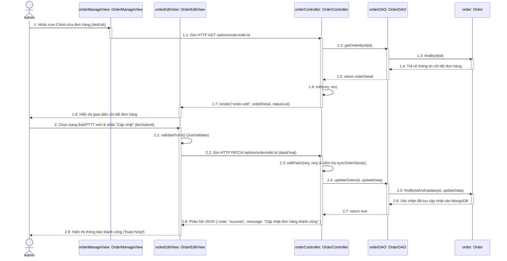

# THIẾT KẾ HỆ THỐNG: CHỨC NĂNG QUẢN LÝ ĐƠN HÀNG (ORDER MANAGEMENT)
> **Dự án:** Hệ thống Website Du lịch & Quản lý Tour (Project-5)  
> **Ngôn ngữ & Nền tảng:** **Node.js, Express.js, MongoDB (Mongoose ODM), Pug Template & Client JS DOM**  
> **Nội dung:** 
> 1. Sơ đồ lớp thiết kế (Design Class Diagram) module Quản lý đơn hàng
> 2. Sơ đồ tuần tự thiết kế (Design Sequence Diagram) chức năng Cập nhật thông tin đơn hàng

---

## I. SƠ ĐỒ LỚP THIẾT KẾ (DESIGN CLASS DIAGRAM) - MODULE QUẢN LÝ ĐƠN HÀNG

Sơ đồ tuân thủ nghiêm ngặt chuẩn kiến trúc môn **Phân tích Thiết kế Hệ thống Hướng đối tượng (OOAD)**:
* Có lớp cha cơ sở **`DAO`** (`-con: Connection`) và lớp con **`OrderDAO`** kế thừa (`DAO <|-- OrderDAO`).
* Mọi thuộc tính đều theo đúng định dạng: 👉 **`-tênTrường: KiểuDữLiệu`**.
* Mọi phương thức đều theo đúng định dạng: 👉 **`+tênPhươngThức(thamSố: Kiểu): KiểuTrảVề`**.

```mermaid
classDiagram
    direction TB

    %% ==========================================
    %% 1. TẦNG GIAO DIỆN (BOUNDARY / VIEW)
    %% ==========================================
    class AdminSiderView {
        <<boundary>>
        -linkDashboard: HTMLAnchorElement
        -linkTour: HTMLAnchorElement
        -linkOrder: HTMLAnchorElement
        -linkSetting: HTMLAnchorElement
        -user: AccountAdmin
        +render(): HTML
    }

    class OrderManageView {
        <<boundary>>
        -selStatusFilter: HTMLSelectElement
        -inputStartDate: HTMLInputElement
        -inputEndDate: HTMLInputElement
        -selPaymentFilter: HTMLSelectElement
        -btnResetFilter: HTMLDivElement
        -formSearch: HTMLFormElement
        -inputSearch: HTMLInputElement
        -formChangeMulti: HTMLFormElement
        -selAction: HTMLSelectElement
        -btnApplyMulti: HTMLButtonElement
        -tblOrder: HTMLTableElement
        -chkCheckAll: HTMLInputElement
        -chkItems: NodeList~HTMLInputElement~
        -listBtnDelete: NodeList~HTMLAnchorElement~
        -selPagination: HTMLSelectElement
        -user: AccountAdmin
        +render(orderList: Array, pagination: Object): HTML
        +handleFilter(): void
        +handleSearch(keyword: String): void
        +handleDelete(id: String): void
        +handleChangeMulti(listId: Array, option: String): void
        +handlePagination(page: Number): void
    }

    class OrderEditView {
        <<boundary>>
        -formOrderEdit: HTMLFormElement
        -inputFullName: HTMLInputElement
        -inputPhone: HTMLInputElement
        -txtNote: HTMLTextAreaElement
        -selPaymentMethod: HTMLSelectElement
        -inputPaidAt: HTMLInputElement
        -inputOrderDate: HTMLInputElement
        -selStatus: HTMLSelectElement
        -btnSubmit: HTMLButtonElement
        -linkBack: HTMLAnchorElement
        -user: AccountAdmin
        +render(orderDetail: Order): HTML
        +validateForm(): Boolean
        +handleSubmit(event: Event): void
    }

    %% ==========================================
    %% 2. TẦNG ĐIỀU KHIỂN (CONTROLLER)
    %% ==========================================
    class OrderController {
        <<controller>>
        -orderDAO: OrderDAO
        +list(req: Request, res: Response): Promise~void~
        +edit(req: Request, res: Response): Promise~void~
        +editPatch(req: Request, res: Response): Promise~void~
        +deletePatch(req: Request, res: Response): Promise~void~
        +changeMultiPatch(req: Request, res: Response): Promise~void~
    }

    %% ==========================================
    %% 3. TẦNG TRUY CẬP DỮ LIỆU (DATA ACCESS OBJECT - DAO)
    %% ==========================================
    class DAO {
        <<dataAccess>>
        -con: Connection
        +DAO()
    }

    class OrderDAO {
        <<dataAccess>>
        +OrderDAO()
        +getOrderList(filter: Object, skip: Number, limit: Number): Promise~Array~
        +countOrders(filter: Object): Promise~Number~
        +getOrderById(id: String): Promise~Order~
        +updateOrder(id: String, updateData: Object): Promise~Boolean~
        +deleteOrder(id: String, adminId: String): Promise~Boolean~
        +changeMultiOrder(listId: Array, option: String, adminId: String): Promise~Boolean~
    }

    %% ==========================================
    %% 4. TẦNG THỰC THỂ (ENTITY MODEL)
    %% ==========================================
    class Order {
        <<entity>>
        -_id: ObjectId
        -code: String
        -accountId: String
        -fullName: String
        -phone: String
        -note: String
        -items: Array~OrderItem~
        -subTotal: Number
        -discount: Number
        -total: Number
        -paymentMethod: String
        -status: String
        -stockReserved: Boolean
        -paidAt: Date
        -updatedBy: String
        -deleted: Boolean
        -deletedBy: String
        -deletedAt: Date
        -createdAt: Date
        -updatedAt: Date
    }

    class OrderItem {
        <<entity>>
        -tourId: String
        -tourName: String
        -avatar: String
        -quantityAdult: Number
        -quantityChildren: Number
        -quantityBaby: Number
        -newPriceAdult: Number
        -newPriceChildren: Number
        -newPriceBaby: Number
        -departureDate: Date
        -cityName: String
    }

    class AccountAdmin {
        <<entity>>
        -_id: ObjectId
        -fullName: String
        -email: String
        -role: String
        -status: String
    }

    %% ==========================================
    %% MỐI QUAN HỆ GIỮA CÁC LỚP (RELATIONSHIPS)
    %% ==========================================
    AdminSiderView --> OrderManageView : Click menu "Quản lý đơn hàng"
    OrderManageView --> OrderEditView : Click icon Sửa đơn hàng

    OrderManageView ..> OrderController : Gửi Request (GET list / PATCH delete / PATCH change-multi)
    OrderEditView ..> OrderController : Gửi Request (PATCH edit)

    OrderController --> OrderDAO : Gọi các hàm xử lý dữ liệu

    DAO <|-- OrderDAO : Kế thừa
    OrderDAO --> Order : Thao tác CRUD thực thể Order
    Order "1" *-- "*" OrderItem : Chứa danh sách các tour đặt
    AccountAdmin "1" ..> "*" Order : Nhân viên cập nhật đơn (updatedBy)
```

---

## II. SƠ ĐỒ TUẦN TỰ THIẾT KẾ (DESIGN SEQUENCE DIAGRAM)
### CHỨC NĂNG: CẬP NHẬT THÔNG TIN ĐƠN HÀNG (UPDATE ORDER)

Sơ đồ thể hiện chi tiết hai giai đoạn:
1. **Giai đoạn 1:** Admin nhấn icon chỉnh sửa trên danh sách $\rightarrow$ Hệ thống truy vấn chi tiết đơn hàng và hiển thị giao diện.
2. **Giai đoạn 2:** Admin thay đổi trạng thái (status) hoặc phương thức thanh toán $\rightarrow$ Hệ thống kiểm tra chỗ trống (stock), cập nhật vào MongoDB và thông báo thành công.

---

## III. BẢNG MÔ TẢ CHI TIẾT CÁC THÔNG ĐIỆP (SEQUENCE MESSAGES)

| STT | Thông điệp / Phương thức | Đối tượng gửi $\rightarrow$ nhận | Giải thích chi tiết theo mã nguồn thực tế |
| :---: | :--- | :--- | :--- |
| **1** | `Nhấn icon Chỉnh sửa` | `Admin` $\rightarrow$ `orderManageView` | Người quản trị click vào nút sửa `<a href="/admin/order/edit/:id">` trên dòng đơn hàng. |
| **1.1** | `GET /admin/order/edit/:id` | `orderManageView` $\rightarrow$ `orderController` | Trình duyệt gửi HTTP GET request kèm `id` đơn hàng lên server. |
| **1.2** | `getOrderById(id)` | `orderController` $\rightarrow$ `orderDAO` | Controller yêu cầu tầng DAO lấy dữ liệu chi tiết đơn hàng. |
| **1.3 - 1.4** | `findById(id)` | `orderDAO` $\rightarrow$ `order` | Mongoose Model thực hiện truy vấn collection `orders` trong MongoDB. |
| **1.5** | `return orderDetail` | `orderDAO` $\rightarrow$ `orderController` | DAO trả về đối tượng đơn hàng chứa mã đơn, họ tên, danh sách tour đã đặt, tổng tiền... |
| **1.6 - 1.7** | `render("order-edit", ...)` | `orderController` $\rightarrow$ `orderEditView` | Server render file template `views/admin/pages/order-edit.pug` gửi về trình duyệt. |
| **1.8** | `Hiển thị giao diện` | `orderEditView` $\rightarrow$ `Admin` | Admin xem thông tin đơn hàng và các trường chọn: trạng thái (Pending/Paid/Done/Cancel), PTTT. |
| **2** | `Thay đổi & nhấn "Cập nhật"` | `Admin` $\rightarrow$ `orderEditView` | Admin đổi trạng thái (ví dụ từ "chờ duyệt" sang "đã thanh toán") và click nút Cập nhật. |
| **2.1** | `validateForm()` | `orderEditView` $\rightarrow$ self | Client JS kiểm tra dữ liệu bằng thư viện `JustValidate`. |
| **2.2** | `PATCH /admin/order/edit/:id` | `orderEditView` $\rightarrow$ `orderController` | Hàm `fetch()` gửi request `PATCH` kèm body JSON `{ status, paymentMethod, note... }`. |
| **2.3** | `editPatch()` & `syncOrderStock()` | `orderController` $\rightarrow$ self | Controller gọi `syncOrderStock()` kiểm tra xem nếu mở lại đơn thì Tour có còn đủ chỗ trống hay không. |
| **2.4 - 2.6** | `updateOrder()` & `findByIdAndUpdate()` | `orderController` $\rightarrow$ `orderDAO` $\rightarrow$ `order` | Cập nhật trạng thái mới, `updatedBy = adminId` và `paidAt` (nếu là paid) vào MongoDB. |
| **2.7 - 2.8** | `res.json({ code: "success" })` | `orderController` $\rightarrow$ `orderEditView` | Controller phản hồi kết quả thành công dưới dạng JSON. |
| **2.9** | `Thông báo thành công` | `orderEditView` $\rightarrow$ `Admin` | Thư viện `notyf.success()` hiển thị thông báo xanh góc màn hình mà không cần reload trang. |

---

## IV. BẢNG ĐỐI CHIẾU SƠ ĐỒ VỚI FILE TRONG PROJECT

| Tên lớp trong sơ đồ | File tương ứng trong dự án | Ghi chú vai trò |
| :--- | :--- | :--- |
| **`AdminSiderView`** | `views/admin/partials/sider.pug` | Menu thanh bên trái chứa mục *"Quản lý đơn hàng"* (`/admin/order/list`). |
| **`OrderManageView`** | `views/admin/pages/order-list.pug` `public/admin/assets/js/script.js` | Giao diện bảng danh sách đơn hàng, bộ lọc ngày tháng, trạng thái, tìm kiếm và phân trang. |
| **`OrderEditView`** | `views/admin/pages/order-edit.pug` `public/admin/assets/js/script.js` | Giao diện chi tiết đơn hàng, form cập nhật trạng thái đơn và phương thức thanh toán. |
| **`OrderController`** | `controllers/admin/order.controller.js` | Chứa các hàm xử lý `list`, `edit`, `editPatch`, `deletePatch`, `changeMultiPatch`. |
| **`DAO`** | Lớp cơ sở kết nối CSDL | Chứa thuộc tính `-con: Connection` (`mongoose.connection`). |
| **`OrderDAO`** | Tầng truy cập dữ liệu đơn hàng | Kế thừa từ `DAO`, đóng gói các câu lệnh truy vấn MongoDB cho collection `orders`. |
| **`Order`** | `models/order.model.js` | Mongoose Model thực thể đơn hàng trong MongoDB. |
| **`OrderItem`** | Thuộc tính `items: Array` trong `Order` | Thực thể con lưu chi tiết từng tour trong đơn (tên tour, số lượng vé, giá tiền...). |

