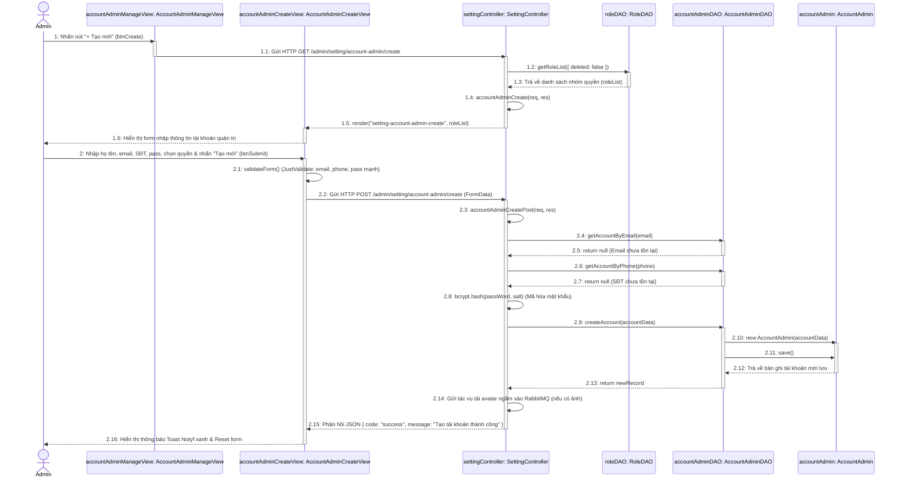

# THIẾT KẾ HỆ THỐNG: CHỨC NĂNG QUẢN LÝ TÀI KHOẢN QUẢN TRỊ (ACCOUNT ADMIN)
> **Dự án:** Hệ thống Website Du lịch & Quản lý Tour (Project-5)  
> **Ngôn ngữ & Nền tảng:** **Node.js, Express.js, MongoDB (Mongoose ODM), Pug Template & Client JS DOM**  
> **Nội dung:**
> 1. Sơ đồ lớp thiết kế (Design Class Diagram) module Quản lý tài khoản quản trị
> 2. Sơ đồ tuần tự thiết kế (Design Sequence Diagram) chức năng Tạo tài khoản quản trị

---

## I. SƠ ĐỒ LỚP THIẾT KẾ (DESIGN CLASS DIAGRAM) - QUẢN LÝ TÀI KHOẢN QUẢN TRỊ

Sơ đồ tuân thủ nghiêm ngặt chuẩn kiến trúc môn **Phân tích Thiết kế Hệ thống Hướng đối tượng (OOAD)**:
* Có lớp cha cơ sở **`DAO`** (`-con: Connection`) và lớp con **`AccountAdminDAO`** kế thừa (`DAO <|-- AccountAdminDAO`).
* Mọi thuộc tính đều tuân thủ định dạng: 👉 **`-tênTrường: KiểuDữLiệu`**.
* Mọi phương thức đều tuân thủ định dạng: 👉 **`+tênPhươngThức(thamSố: Kiểu): KiểuTrảVề`**.

```mermaid
classDiagram
    direction TB

    %% ==========================================
    %% 1. TẦNG GIAO DIỆN (BOUNDARY / VIEW)
    %% ==========================================
    class SettingListView {
        <<boundary>>
        -linkWebsiteInfo: HTMLAnchorElement
        -linkAccountAdmin: HTMLAnchorElement
        -linkRoleList: HTMLAnchorElement
        -user: AccountAdmin
        +render(): HTML
    }

    class AccountAdminManageView {
        <<boundary>>
        -selStatusFilter: HTMLSelectElement
        -formSearch: HTMLFormElement
        -inputSearch: HTMLInputElement
        -btnCreate: HTMLAnchorElement
        -formChangeMulti: HTMLFormElement
        -selAction: HTMLSelectElement
        -btnApplyMulti: HTMLButtonElement
        -tblAccountAdmin: HTMLTableElement
        -chkCheckAll: HTMLInputElement
        -chkItems: NodeList~HTMLInputElement~
        -listBtnDelete: NodeList~HTMLAnchorElement~
        -selPagination: HTMLSelectElement
        -user: AccountAdmin
        +render(accountAdminList: Array, roleList: Array, pagination: Object): HTML
        +handleFilter(): void
        +handleSearch(keyword: String): void
        +handleDelete(id: String): void
        +handleChangeMulti(listId: Array, option: String): void
        +handlePagination(page: Number): void
    }

    class AccountAdminCreateView {
        <<boundary>>
        -formCreate: HTMLFormElement
        -inputFullName: HTMLInputElement
        -inputEmail: HTMLInputElement
        -inputPhone: HTMLInputElement
        -selRole: HTMLSelectElement
        -inputPositionCompany: HTMLInputElement
        -selStatus: HTMLSelectElement
        -inputPassword: HTMLInputElement
        -fileAvatar: HTMLInputElement
        -btnSubmit: HTMLButtonElement
        -linkBack: HTMLAnchorElement
        -user: AccountAdmin
        +render(roleList: Array): HTML
        +validateForm(): Boolean
        +handleSubmit(event: Event): void
    }

    class AccountAdminEditView {
        <<boundary>>
        -formEdit: HTMLFormElement
        -inputFullName: HTMLInputElement
        -inputEmail: HTMLInputElement
        -inputPhone: HTMLInputElement
        -selRole: HTMLSelectElement
        -inputPositionCompany: HTMLInputElement
        -selStatus: HTMLSelectElement
        -fileAvatar: HTMLInputElement
        -btnSubmit: HTMLButtonElement
        -linkBack: HTMLAnchorElement
        -user: AccountAdmin
        +render(accountAdminDetail: AccountAdmin, roleList: Array): HTML
        +validateForm(): Boolean
        +handleSubmit(event: Event): void
    }

    %% ==========================================
    %% 2. TẦNG ĐIỀU KHIỂN (CONTROLLER)
    %% ==========================================
    class SettingController {
        <<controller>>
        -accountAdminDAO: AccountAdminDAO
        -roleDAO: RoleDAO
        +accountAdminList(req: Request, res: Response): Promise~void~
        +accountAdminCreate(req: Request, res: Response): Promise~void~
        +accountAdminCreatePost(req: Request, res: Response): Promise~void~
        +accountAdminEdit(req: Request, res: Response): Promise~void~
        +accountAdminEditPatch(req: Request, res: Response): Promise~void~
        +accountAdminDeletePatch(req: Request, res: Response): Promise~void~
        +accountAdminChangeMultiPatch(req: Request, res: Response): Promise~void~
        +accountAdminChangePassword(req: Request, res: Response): Promise~void~
        +accountAdminChangePasswordPatch(req: Request, res: Response): Promise~void~
    }

    %% ==========================================
    %% 3. TẦNG TRUY CẬP DỮ LIỆU (DAO)
    %% ==========================================
    class DAO {
        <<dataAccess>>
        -con: Connection
        +DAO()
    }

    class AccountAdminDAO {
        <<dataAccess>>
        +AccountAdminDAO()
        +getAccountList(filter: Object, skip: Number, limit: Number): Promise~Array~
        +countAccounts(filter: Object): Promise~Number~
        +getAccountById(id: String): Promise~AccountAdmin~
        +getAccountByEmail(email: String): Promise~AccountAdmin~
        +getAccountByPhone(phone: String): Promise~AccountAdmin~
        +createAccount(data: Object): Promise~AccountAdmin~
        +updateAccount(id: String, data: Object): Promise~Boolean~
        +deleteAccount(id: String, adminId: String): Promise~Boolean~
        +changeMultiAccount(listId: Array, option: String, adminId: String): Promise~Boolean~
    }

    class RoleDAO {
        <<dataAccess>>
        +RoleDAO()
        +getRoleList(filter: Object): Promise~Array~
    }

    %% ==========================================
    %% 4. TẦNG THỰC THỂ (ENTITY MODEL)
    %% ==========================================
    class AccountAdmin {
        <<entity>>
        -_id: ObjectId
        -fullName: String
        -email: String
        -phone: String
        -role: String
        -positionCompany: String
        -status: String
        -passWord: String
        -avatar: String
        -createdBy: String
        -updatedBy: String
        -slug: String
        -deleted: Boolean
        -deletedBy: String
        -deletedAt: Date
        -createdAt: Date
        -updatedAt: Date
    }

    class Role {
        <<entity>>
        -_id: ObjectId
        -roleName: String
        -rolePermissions: Array~String~
        -deleted: Boolean
    }

    %% ==========================================
    %% MỐI QUAN HỆ GIỮA CÁC LỚP (RELATIONSHIPS)
    %% ==========================================
    SettingListView --> AccountAdminManageView : Click ô "Tài khoản quản trị"
    AccountAdminManageView --> AccountAdminCreateView : Click nút "+ Tạo mới"
    AccountAdminManageView --> AccountAdminEditView : Click icon Chỉnh sửa

    AccountAdminManageView ..> SettingController : Gửi Request (GET list / PATCH delete / PATCH change-multi)
    AccountAdminCreateView ..> SettingController : Gửi Request (POST create)
    AccountAdminEditView ..> SettingController : Gửi Request (PATCH edit)

    SettingController --> AccountAdminDAO : Thao tác dữ liệu tài khoản
    SettingController --> RoleDAO : Lấy danh sách nhóm quyền (roleList)

    DAO <|-- AccountAdminDAO : Kế thừa
    DAO <|-- RoleDAO : Kế thừa
    AccountAdminDAO --> AccountAdmin : Thao tác CRUD thực thể AccountAdmin
    AccountAdmin "n" --> "1" Role : Gán quyền theo nhóm quyền (role ID)
```

---

## II. SƠ ĐỒ TUẦN TỰ THIẾT KẾ (DESIGN SEQUENCE DIAGRAM)
### CHỨC NĂNG: TẠO TÀI KHOẢN QUẢN TRỊ (CREATE ACCOUNT ADMIN)

Sơ đồ thể hiện chi tiết hai giai đoạn:
1. **Giai đoạn 1:** Admin nhấn `+ Tạo mới` $\rightarrow$ Server nạp danh sách nhóm quyền (`roleList`) $\rightarrow$ Hiển thị form tạo tài khoản.
2. **Giai đoạn 2:** Admin nhập thông tin, mật khẩu, chọn nhóm quyền $\rightarrow$ Client validate $\rightarrow$ Server kiểm tra email/SĐT trùng $\rightarrow$ Băm mật khẩu (Bcrypt) $\rightarrow$ Lưu vào MongoDB $\rightarrow$ Báo thành công.

---

## III. BẢNG MÔ TẢ CHI TIẾT CÁC THÔNG ĐIỆP (SEQUENCE MESSAGES)

| STT | Thông điệp / Phương thức | Đối tượng gửi $\rightarrow$ nhận | Giải thích chi tiết theo mã nguồn thực tế |
| :---: | :--- | :--- | :--- |
| **1** | `Nhấn nút "+ Tạo mới"` | `Admin` $\rightarrow$ `accountAdminManageView` | Người quản trị click vào thẻ `<a href="/admin/setting/account-admin/create">` trên bảng danh sách. |
| **1.1** | `GET /account-admin/create` | `accountAdminManageView` $\rightarrow$ `settingController` | Trình duyệt gửi HTTP GET request lên server. |
| **1.2 - 1.3** | `getRoleList()` | `settingController` $\rightarrow$ `roleDAO` | Server truy vấn danh sách các nhóm quyền hiện có để đổ dữ liệu vào ô chọn `<select name="role">`. |
| **1.4 - 1.5** | `render("setting-account-admin-create", roleList)` | `settingController` $\rightarrow$ `accountAdminCreateView` | Server render file template Pug thành giao diện HTML trả về cho client. |
| **1.6** | `Hiển thị form` | `accountAdminCreateView` $\rightarrow$ `Admin` | Giao diện hiện đầy đủ các trường: Họ tên, Email, SĐT, Chọn nhóm quyền, Chức vụ, Mật khẩu, Ảnh đại diện. |
| **2** | `Nhập liệu & nhấn "Tạo mới"` | `Admin` $\rightarrow$ `accountAdminCreateView` | Người dùng điền thông tin và nhấn nút submit form. |
| **2.1** | `validateForm()` | `accountAdminCreateView` $\rightarrow$ self | Thư viện `JustValidate` kiểm tra định dạng email, regex SĐT Việt Nam, mật khẩu tối thiểu 8 ký tự kèm chữ hoa, số, ký tự đặc biệt. |
| **2.2** | `POST /account-admin/create` | `accountAdminCreateView` $\rightarrow$ `settingController` | Client JS đóng gói `FormData` và gọi `fetch()` gửi lên server. |
| **2.3** | `accountAdminCreatePost(req, res)` | `settingController` $\rightarrow$ self | Controller tiếp nhận request xử lý. |
| **2.4 - 2.7** | Kiểm tra trùng Email & SĐT | `settingController` $\rightarrow$ `accountAdminDAO` | Gọi `findOne({ email })` và `findOne({ phone })` để đảm bảo tài khoản là duy nhất trên hệ thống. |
| **2.8** | `bcrypt.hash()` | `settingController` $\rightarrow$ self | Mã hóa mật khẩu với chuỗi muối `salt = genSalt(10)`. |
| **2.9 - 2.11** | `createAccount()` & `save()` | `accountAdminDAO` $\rightarrow$ `accountAdmin` | Tạo đối tượng Mongoose `new AccountAdmin()` và ghi vào collection `accounts-admin` trong MongoDB. |
| **2.14** | `sendToQueue()` | `settingController` $\rightarrow$ RabbitMQ | Đẩy tác vụ tải ảnh đại diện lên Cloudinary ngầm vào hàng đợi `media_upload_queue`. |
| **2.15** | `res.json({ code: "success" })` | `settingController` $\rightarrow$ `accountAdminCreateView` | Server phản hồi JSON xác nhận tạo thành công. |
| **2.16** | `Hiển thị Toast Notyf & Reset` | `accountAdminCreateView` $\rightarrow$ `Admin` | Trình duyệt hiện thông báo thành công xanh, reset ô nhập và xóa file FilePond mà không cần reload trang. |

---

## IV. BẢNG ĐỐI CHIẾU SƠ ĐỒ VỚI FILE TRONG PROJECT

| Tên lớp trong sơ đồ | File tương ứng trong dự án | Ghi chú vai trò |
| :--- | :--- | :--- |
| **`SettingListView`** | `views/admin/pages/setting-list.pug` | Màn hình "Cài đặt chung" chứa ô *"Tài khoản quản trị"* (`/admin/setting/account-admin/list`). |
| **`AccountAdminManageView`** | `views/admin/pages/setting-account-admin-list.pug` `public/admin/assets/js/script.js` | Bảng danh sách tài khoản quản trị viên, tìm kiếm theo tên/SĐT/email, lọc trạng thái, phân trang. |
| **`AccountAdminCreateView`** | `views/admin/pages/setting-account-admin-create.pug` `public/admin/assets/js/script.js` | Form tạo mới tài khoản quản trị, tích hợp upload ảnh FilePond và validate mật khẩu mạnh. |
| **`SettingController`** | `controllers/admin/setting.controller.js` | Chứa các hàm `accountAdminList`, `accountAdminCreate`, `accountAdminCreatePost`... |
| **`DAO`** | Lớp cơ sở kết nối CSDL | Chứa thuộc tính `-con: Connection` (`mongoose.connection`). |
| **`AccountAdminDAO`** | Tầng truy cập dữ liệu tài khoản admin | Kế thừa từ `DAO`, đóng gói các câu lệnh truy vấn MongoDB cho collection `accounts-admin`. |
| **`RoleDAO`** | Tầng truy cập dữ liệu nhóm quyền | Cung cấp danh sách các quyền để gán cho tài khoản. |
| **`AccountAdmin`** | `models/accounts-admin.model.js` | Mongoose Model thực thể tài khoản quản trị trong MongoDB. |
| **`Role`** | `models/role.model.js` | Mongoose Model thực thể nhóm quyền liên kết qua trường `role`. |

