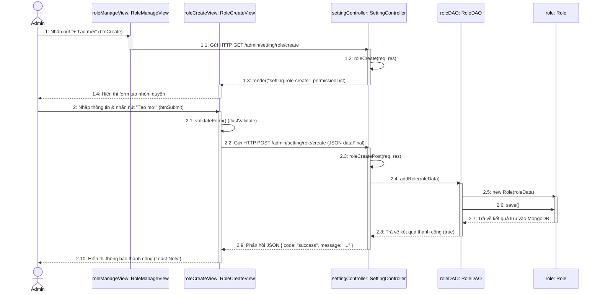
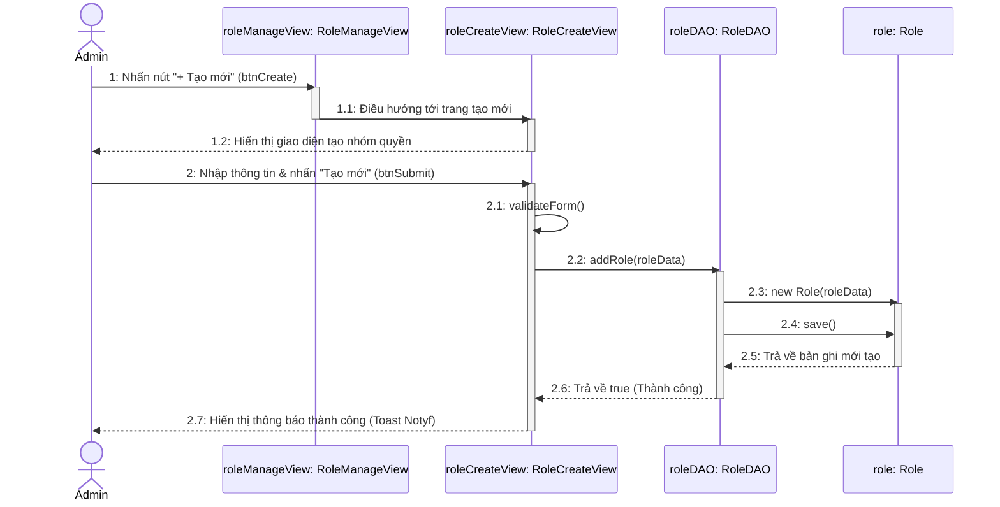

# BIỂU ĐỒ TUẦN TỰ THIẾT KẾ (DESIGN SEQUENCE DIAGRAM)
## CHỨC NĂNG: TẠO NHÓM QUYỀN (ADD ROLE)
> **Dự án:** Hệ thống Website Du lịch & Quản lý Tour (Project-5)  
> **Nền tảng:** **Node.js, Express.js, MongoDB (Mongoose), Pug & Client JS DOM**  
> **Khớp 100% với:** Sơ đồ lớp thiết kế và Mã nguồn thực tế

---

## I. TẠI SAO SƠ ĐỒ TUẦN TỰ CŨ (HÌNH 3.13) BỊ SAI?

1. **Sai lệch về công nghệ (Java Desktop vs Web):**
   * Sơ đồ cũ có thông điệp `1.1: actionPerformed(e : ActionEvent)` và `1.2: new RoleEditFrm(user, null)`. Đây là cơ chế hứng sự kiện click chuột và khởi tạo cửa sổ giao diện của **Java Swing Desktop**.
   * Trên nền tảng **Web Node.js**, khi Admin nhấn nút trên giao diện, trình duyệt sẽ gửi request HTTP (`GET` hoặc `POST`) qua mạng tới server Express.
2. **Tách biệt rõ ràng giữa Tạo mới và Chỉnh sửa:**
   * Sơ đồ cũ dùng chung màn hình `RoleEditView` cho cả thêm và sửa (`new RoleEditFrm(user, null)`).
   * Trong dự án thực tế, bạn có riêng trang **`RoleCreateView`** (`views/admin/pages/setting-role-create.pug`) để tạo mới và **`RoleEditView`** (`views/admin/pages/setting-role-edit.pug`) để chỉnh sửa.
3. **Thiếu tầng Controller của kiến trúc Web MVC:**
   * Trong ứng dụng web, trình duyệt (Client View) không thể gọi trực tiếp tới `RoleDAO` trên Database được mà bắt buộc phải gửi Request qua **Router & `SettingController`**.
4. **Tên thực thể và phương thức chưa khớp:**
   * Thực thể là **`Role`** (thay vì `NhomQuyenQuanTri`).
   * Dữ liệu gửi lên là JSON body gồm `{ roleName, description, rolePermissions }`.

---

## II. SƠ ĐỒ TUẦN TỰ THIẾT KẾ CHUẨN (KIẾN TRÚC WEB MVC NODE.JS)

Sơ đồ thể hiện đầy đủ luồng tương tác giữa **Admin $\rightarrow$ View (HTML/JS) $\rightarrow$ Controller $\rightarrow$ DAO $\rightarrow$ Model (MongoDB)**:

---

## III. PHIÊN BẢN 2: BỐ CỤC 4 ĐỐI TƯỢNG (GIỮ NGUYÊN FORM CŨ CỦA THẦY)

Nếu thầy giáo của bạn yêu cầu **giữ nguyên đúng 4 cột đối tượng** như trong Hình 3.13 cũ (View gọi thẳng tới DAO mà không vẽ thêm Controller):

---

## IV. BẢNG MÔ TẢ CHI TIẾT CÁC THÔNG ĐIỆP (MESSAGES TRONG PHIÊN BẢN CHUẨN)

| STT | Thông điệp / Phương thức | Đối tượng gửi $\rightarrow$ nhận | Mô tả chi tiết trong mã nguồn thực tế |
| :---: | :--- | :--- | :--- |
| **1** | `Nhấn nút "+ Tạo mới"` | `Admin` $\rightarrow$ `roleManageView` | Người quản trị click vào thẻ `<a class="inner-create" href="/admin/setting/role/create">` trên bảng danh sách. |
| **1.1** | `GET /admin/setting/role/create` | `roleManageView` $\rightarrow$ `settingController` | Trình duyệt gửi HTTP GET request đến Router. |
| **1.2** | `roleCreate(req, res)` | `settingController` $\rightarrow$ self | Hàm Controller đọc danh sách các quyền có sẵn từ `configs/variable.config.js`. |
| **1.3** | `render("setting-role-create", ...)` | `settingController` $\rightarrow$ `roleCreateView` | Server biên dịch template Pug thành HTML trả về cho client. |
| **1.4** | `Hiển thị form tạo nhóm quyền` | `roleCreateView` $\rightarrow$ `Admin` | Giao diện hiển thị các ô nhập tên, mô tả và danh sách checkbox phân quyền. |
| **2** | `Nhập liệu & nhấn nút "Tạo mới"` | `Admin` $\rightarrow$ `roleCreateView` | Người dùng nhập tên nhóm quyền, mô tả, tích chọn quyền và click nút submit. |
| **2.1** | `validateForm()` | `roleCreateView` $\rightarrow$ self | Thư viện `JustValidate` kiểm tra ô tên nhóm quyền không được để trống. |
| **2.2** | `POST /admin/setting/role/create` | `roleCreateView` $\rightarrow$ `settingController` | Client JS gọi hàm `fetch()` gửi body JSON `{ roleName, description, rolePermissions }`. |
| **2.3** | `roleCreatePost(req, res)` | `settingController` $\rightarrow$ self | Controller nhận dữ liệu, gán `req.body.createdBy = res.locals.account.id`. |
| **2.4** | `addRole(roleData)` | `settingController` $\rightarrow$ `roleDAO` | Controller ủy quyền xử lý thêm mới dữ liệu cho lớp DAO. |
| **2.5** | `new Role(roleData)` | `roleDAO` $\rightarrow$ `role` | Khởi tạo thực thể `Role` Mongoose Model với dữ liệu đầu vào. |
| **2.6** | `save()` | `roleDAO` $\rightarrow$ `role` | Ghi tài liệu mới vào collection `roles` trong CSDL MongoDB. |
| **2.7** | `Trả về kết quả lưu` | `role` $\rightarrow$ `roleDAO` | Mongoose hoàn tất ghi vào DB và trả về kết quả. |
| **2.8** | `return true` | `roleDAO` $\rightarrow$ `settingController` | DAO xác nhận đã lưu thành công. |
| **2.9** | `res.json({ code: "success", ... })` | `settingController` $\rightarrow$ `roleCreateView` | Server phản hồi kết quả JSON về cho hàm Fetch ở trình duyệt. |
| **2.10** | `Hiển thị thông báo thành công` | `roleCreateView` $\rightarrow$ `Admin` | Client JS gọi thư viện Notyf (`notyf.success()`) thông báo thành công và load lại trang. |

